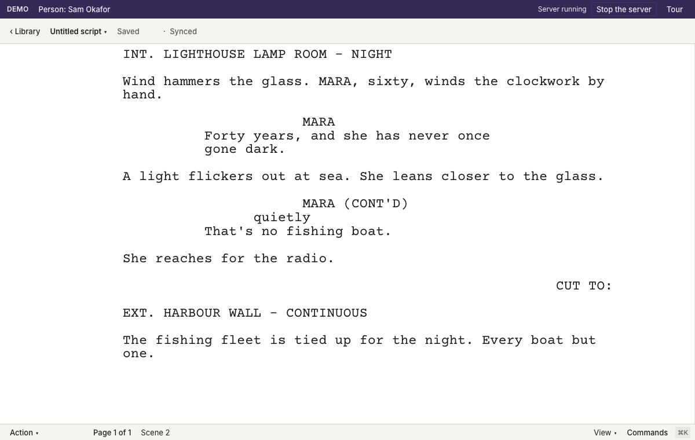

# Manent

An open-source app for writing scripts — screenplays, multi-camera and animation scripts, stage plays, manuscripts, variety scripts, game scripts and Ink — on pages laid out as they print, online or off, and built for several people at once.



## What it is

Manent is a script editor that runs in the browser and keeps every change on your device before it goes to the server. Its pages are laid out as they print: the screen, print and the PDF share one layout. It is built so that several people can work in one script, their changes merging instead of overwriting each other; the table below says how much of that works today.

The repository is a Bun monorepo: React 19 and plain ProseMirror for the editor, a CRDT (Yjs, behind Manent's own interface) for merging, a sync server of its own on Bun and SQLite, and end-to-end tests in Chromium, Firefox and WebKit. Today you run it on your own machine as a demo with six made-up people.

### Status

| Capability                                                                                       | Status                                                                                               |
| ------------------------------------------------------------------------------------------------ | ---------------------------------------------------------------------------------------------------- |
| Writing in eight formats, with the Tab and Enter flow, the element picker and name completion    | Works                                                                                                |
| Exact pages: one layout engine for the screen, print and PDF; (MORE) and (CONT'D); Letter and A4 | Works                                                                                                |
| Saving on the device first, syncing to the server, working without a connection                  | Works                                                                                                |
| Export to PDF, and print                                                                         | Works                                                                                                |
| Command palette, rebindable shortcuts, preferences, themes, keyboard and screen-reader support   | Works; screen-reader support is checked by axe, not yet tested with screen-reader users              |
| Several people in one script: live changes, cursors, merging                                     | In progress: works between tabs of one person; a second person cannot yet open someone else's script |
| The Library of projects and scripts                                                              | In progress: the list is kept per tab and is empty again after a reload                              |
| The demo's content and its guided Tour                                                           | In progress: people and workspaces exist; no seeded scripts, and the Tour's groups are empty         |
| Version history: versions, compare, restore                                                      | In progress: the server side is written and tested but not connected; nothing in the app yet         |
| Production revisions: locked pages, revision colours, asterisks, revised pages                   | Planned: the page model and the packet writer exist as libraries                                     |
| Comments                                                                                         | Planned                                                                                              |
| Import from and export to other script formats                                                   | Planned                                                                                              |
| Desktop app                                                                                      | Planned: its local service exists as a tested library                                                |
| A hosted service with real accounts                                                              | Planned                                                                                              |

The [architecture overview](docs/architecture/overview.md) gives the status of every package and how it was judged.

## Quick start

You need [Bun](https://bun.com) 1.4.4 or later and Git. Manent is built for macOS, Linux and Windows; CI runs on all three, and does not pass on every one yet.

```sh
git clone https://github.com/HMarzban/manent.git
cd manent
make demo        # without make: bun run demo
```

It opens `http://localhost:4747`, where you will see:

1. **Choose who you are.** Six demo people, each with a role; one click, no password. Pick anyone but **You**: You is a new person who is not signed in, so nothing syncs.
2. **The Library**, empty. Click **New script**.
3. **A script page.** Click the page, type `INT. LIGHTHOUSE - NIGHT`, press Escape to close the list of headings, then Enter, and keep writing: Tab and Enter choose the next element for you.

[What to try](docs/guide/getting-started.md#what-to-try) goes on from there: working offline, two tabs, and export. Stop the demo with Ctrl+C or `make stop`.

## Documentation

Start with [Getting started](docs/guide/getting-started.md) to use Manent, [Set up a development copy](docs/development/setup.md) to work on it, or the [architecture overview](docs/architecture/overview.md) to see how it is built. The [documentation index](docs/README.md) lists every page.

## Project status and roadmap

Manent is early and has made no release. Writing, pages, offline saving and sync, export and print work in the demo; the table above says what does not yet. Next, in rough order:

1. Opening and editing a script together as different people, and a Library that is kept.
2. Version history in the app: versions, compare and restore.
3. Production revisions: locked pages, revision colours and revised pages.
4. The demo's scripts and the guided Tour.
5. The desktop app.

The order may change. [CHANGELOG.md](CHANGELOG.md) records what has changed, newest first.

## Contributing

Contributions are welcome. [CONTRIBUTING.md](CONTRIBUTING.md) says how to propose a change and how it is reviewed, and [AGENTS.md](AGENTS.md) holds the rules every change follows. Everyone taking part follows the [code of conduct](CODE_OF_CONDUCT.md).

## Security

Please report a vulnerability privately through GitHub's **Report a vulnerability** form in the repository's Security tab, not in a public issue. [SECURITY.md](SECURITY.md) has the details, and what the password-less demo does and does not protect.

## Acknowledgement

Manent was inspired by [Scripto](https://scripto.com), cloud-based collaborative screenwriting and script management software. The idea of one shared editor for a whole production comes from Scripto, and this project is grateful for it.

Manent is an independent project, written from scratch. It contains no Scripto code, design or content. It is not affiliated with or endorsed by Scripto, and Scripto is a trademark of its owners. Manent explores different directions, such as offline writing, page-accurate pagination and revision history.

Thank you to the Scripto team.

## Licence

Manent is licensed under the Apache License 2.0. The [LICENSE](LICENSE) file is the authority; this paragraph only points to it.

If you like the project, get in touch: https://github.com/HMarzban or marzban98@gmail.com
