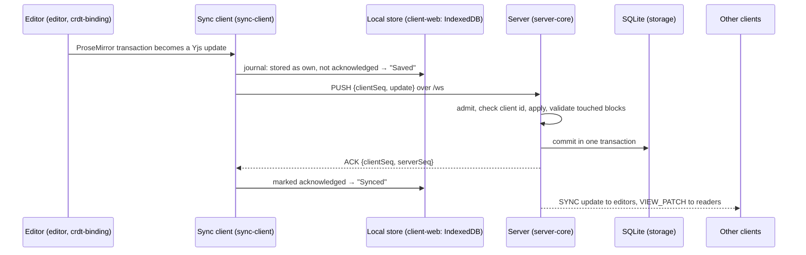

# Architecture overview

How Manent is put together, and how much of it exists. [layers.md](layers.md) has the dependency rules in full and [repository.md](repository.md) the folder outline. Every status on this page was read from the code on `main`:

| Mark            | Meaning                                                                                               |
| --------------- | ----------------------------------------------------------------------------------------------------- |
| **built**       | Does its job end to end, with tests, and is used by the running app or the tooling                    |
| **in progress** | Some of what the part is for works; the rest is missing or is a placeholder file that exports nothing |
| **planned**     | Decided, not written                                                                                  |

## What the system is

1. A script-writing app for film, series, shows, news, podcasts, books and games: true script pages, several people in one script, version history and production revisions.
2. It works offline. Every change is stored on the device first and sent when there is a connection; a change the server has acknowledged is never lost.
3. The editor is plain ProseMirror. Merging is done by a CRDT (Yjs) that exactly one package may import.
4. One server program (Bun and SQLite) is the authority for every synced script: it orders, checks, stores and passes on every change.
5. Today it runs as a demo on one machine, and the desktop app runs the same server program as a child process of its own. A hosted service is planned.

## The system in one diagram

```text
 BROWSER TAB (apps/web)                                     DESKTOP APP (apps/desktop)
 ┌─────────────────────────────────────────────────┐        ┌───────────────────────────────────────────┐
 │ React screens: chooser, Library, script,        │        │ shell: window, menus, dialogs, updater    │
 │   Send (Export, Print, Issue, Recall),          │        │ the same web app in the window            │
 │   Preferences                         [built]   │        │ local node (packages/local-node):         │
 │ editor: ProseMirror, pages, picker,             │        │   loopback service, SQLite store,         │
 │   find, changes, revision marks       [built]   │        │   relay to the server            [built]  │
 │   CRDT binding · presence             [built]   │        └────────────────────┬──────────────────────┘
 │ sync client: link, journal, outbox,             │                             │
 │   history, production                 [built]   │                             │
 │ local store: IndexedDB · leader tab   [built]   │                             │
 │ service worker: app shell offline     [built]   │                             │
 └──────────────┬──────────────────────────────────┘                             │
                │ HTTP: sign-in, session, script, version and production routes, │
                │   socket ticket                                                │
                │ WebSocket /ws: one binary socket for every open script         │
                ▼                                                                ▼
 ┌──────────────────────────────────────────────────────────────────────────────────────────────────┐
 │ SERVER PROGRAM (apps/server → server-core), one Bun process: the authority                       │
 │   HTTP edge: host and origin checks, routes, demo sign-in, sessions, static web app   [built]    │
 │   socket: single-use tickets, handshake, version gate                                 [built]    │
 │   rooms: one live document per open script                                            [built]    │
 │   write path: admit → identity → apply → validate → commit → acknowledge → publish    [built]    │
 │   checkpoints on a worker thread · healing · rebuilds and replays                     [built]    │
 │   version history: record, list, open, name, restore                                  [built]    │
 │   production revisions: lock, issue, recall, layout changes                           [built]    │
 └──────────────┬───────────────────────────────────────────────────────────────────────────────────┘
                ▼
   SQLite files: control.sqlite (people, roles), one file per project or person, a checkpoints file beside each
```

### Where it runs

| Setting            | Clients                                                       | Server program                                                              | Storage                                           | Status                                                                                                                                                     |
| ------------------ | ------------------------------------------------------------- | --------------------------------------------------------------------------- | ------------------------------------------------- | ---------------------------------------------------------------------------------------------------------------------------------------------------------- |
| Demo, one machine  | Browser tabs on `http://localhost:4747`; each tab is a person | On the same machine under a supervisor; loopback only                       | `.manent-demo/`: the session key and SQLite files | **built**                                                                                                                                                  |
| Demo, two machines | A second machine on the same private network                  | Also listens on one private-range address; refuses a public or wildcard one | The same                                          | **in progress**: `make demo LAN=1` listens; the browser keeps its offline copy of the app only on `localhost`                                              |
| Desktop            | The app's own window                                          | A local node inside the app relays to the server, which stays the authority | SQLite in the system's app-data folder            | **built**: unsigned installers; the app runs on the demo server it starts, with history and production revisions, and opens Final Draft and Fountain files |
| Hosted             | Browsers and desktop apps                                     | The same program behind a proxy that ends TLS                               | The same files, with backups off the machine      | **planned**                                                                                                                                                |

The demo replaces only sign-in. Sync, the write path, storage and recovery are the real ones, running locally.

## Packages

Dependencies point down; no edge points up. The layers and each package's allowed imports are data in `tools/boundaries.config.ts`, and [layers.md](layers.md) reads them out.

```text
 Presentation and composition   ui · demo · web · server · desktop                               screens, demo content, entry points
 Application                    crdt-binding · editor · commands                                 editing and the commands behind it
 Services                       sync-client · client-web · storage · server-core · local-node    sync, storage, the authority
 Domain engines                 pagination · revisions · crdt · formats                          the document's rules, as libraries
 Kernel                         schema · settings · sync-protocol · perf                         shared values and rules
 Tooling                        testkit · bench · e2e · tools                                    outside the layers
```

Every workspace, its job and its status:

| Package         | Layer                        | Responsibility                                                                                                                                                                                   | Status                                                                                                                                                                                                 |
| --------------- | ---------------------------- | ------------------------------------------------------------------------------------------------------------------------------------------------------------------------------------------------ | ------------------------------------------------------------------------------------------------------------------------------------------------------------------------------------------------------ |
| `schema`        | Kernel                       | The document schema: sections, one block node, the elements and marks of eight formats, block identity, validation, repairs, canonical JSON                                                      | **built**                                                                                                                                                                                              |
| `settings`      | Kernel                       | The settings registry: definitions, validation, scopes, the store, and every preference and script setting                                                                                       | **built**                                                                                                                                                                                              |
| `sync-protocol` | Kernel                       | The wire: binary frames, messages, chunking, version gating, error codes, and the bodies of the HTTP routes as shared types                                                                      | **built**                                                                                                                                                                                              |
| `perf`          | Kernel                       | Timing marks that ship in the product, off until switched on, in a fixed ring buffer                                                                                                             | **built**                                                                                                                                                                                              |
| `pagination`    | Domain engines               | The page engine: a pure function from blocks to positioned lines, with break and keep rules, dual dialogue, labels and scene numbers                                                             | **built**                                                                                                                                                                                              |
| `revisions`     | Domain engines               | Block-aligned script compare, row-aligned rundown compare, three-way merge by block, restore plans, and the production model (locked pages, page marks, colours)                                 | **built**                                                                                                                                                                                              |
| `crdt`          | Domain engines               | The only importer of Yjs: documents, rundowns, templates strip/mint, the body as the editor's view, writes addressed to a block, awareness, undo scope                                           | **built**                                                                                                                                                                                              |
| `formats`       | Domain engines               | Files in and out: PDF from the page engine's output, issued revision packets, MOS 2.8.5 / Autoscript WinPlus-IP wire encoding, FDX, Fountain, Game Script, Ink and rundown exports               | **built**                                                                                                                                                                                              |
| `sync-client`   | Services                     | The client's sync: the link state machine, journal and outbox, handshake, leader and follower tabs, read-only `ViewHandle`, recovery, versions and production, all behind ports                  | **built**                                                                                                                                                                                              |
| `client-web`    | Services                     | The sync client's browser drivers: IndexedDB store, project-scoped offline asset cache and uploader, Web Locks leader with a lease fallback, socket and fetch transport, the production cache    | **built**                                                                                                                                                                                              |
| `storage`       | Services                     | Storage ports and their drivers: SQLite for the server (including project-scoped assets), in memory for tests                                                                                    | **built**                                                                                                                                                                                              |
| `server-core`   | Services                     | `createServer()`: HTTP, sign-in, sessions, the socket, rooms, the write path, checkpoints, healing, history, production, rundowns, live prompter control, external MOS bridge and project assets | **built**                                                                                                                                                                                              |
| `local-node`    | Services                     | The desktop's loopback service: durable store, relay to the server (including prompter control and LAN MOS relay), outbox, single-instance lock, first-sync hand-off                             | **built**                                                                                                                                                                                              |
| `crdt-binding`  | Application                  | Binds a CRDT document to the editor: y-prosemirror, undo history, composition hold, presence                                                                                                     | **built**                                                                                                                                                                                              |
| `editor`        | Application                  | `createScriptEditor`: element flow and keys, inline graphics and chyrons, picker, autocomplete, find, the paged view, drift monitor, remote cursors, changes layer, revision marks               | **built**                                                                                                                                                                                              |
| `commands`      | Application                  | The command registry: definitions, key bindings and chords, rebinding checks, the menu model                                                                                                     | **built**                                                                                                                                                                                              |
| `ui`            | Presentation and composition | Components, the command palette, surfaces, theme tokens and every word the interface shows                                                                                                       | **built**                                                                                                                                                                                              |
| `demo`          | Presentation and composition | Demo people and workspaces, the password-less sign-in, the Tour's format and content, the seed and its phrase banks                                                                              | **built**: people, workspaces, sign-in, the seed, simulated writers and 92 Tour scenarios covering writing, collaboration, production, rundowns, prompter, MOS, inline graphics, templates and history |
| `web`           | Presentation and composition | The browser app: routes, screens, editor host, rundowns, live remote-scrolled prompter, inline graphics, templates, Broadcast MOS settings, History, production, Preferences and service worker  | **built**                                                                                                                                                                                              |
| `server`        | Presentation and composition | Reads the environment, opens SQLite storage and a checkpoint worker, seeds the demo, creates the server and listens                                                                              | **built**                                                                                                                                                                                              |
| `desktop`       | Presentation and composition | The desktop shell: window, menus, dialogs, updater, and the app's own server process                                                                                                             | **built**                                                                                                                                                                                              |
| `testkit`       | Tooling                      | Test support: temporary trees, a test server, bots, a seeded sync simulation, fuzzers, DOM setup                                                                                                 | **in progress**: sync and production support are built; desktop support is a placeholder                                                                                                               |
| `bench`         | Tooling                      | The benchmark harness, statistics, budgets and scenarios                                                                                                                                         | **in progress**: the harness and its scenarios run; the published report is not written yet                                                                                                            |
| `e2e`           | Tooling                      | End-to-end tests in Chromium, Firefox and WebKit, and the fresh-clone test                                                                                                                       | **built**                                                                                                                                                                                              |
| `tools`         | Tooling                      | The gate's checks, the demo launcher and supervisor, the Unicode and theme generators, the desktop build tools                                                                                   | **built**                                                                                                                                                                                              |

## Seams

Each seam is an interface placed where a replacement is plausible.

| Seam                | Where                  | Why                                                                                                                                                | Behind it today                                                          |
| ------------------- | ---------------------- | -------------------------------------------------------------------------------------------------------------------------------------------------- | ------------------------------------------------------------------------ |
| CRDT library        | `crdt`, `crdt-binding` | Versions, compare, restore and revisions work on plain documents and block IDs, so they survive a change of library                                | Yjs. The boundary check lets only these two packages import it           |
| Storage             | `storage`              | The server is written against ports, so another driver can replace SQLite                                                                          | SQLite (`bun:sqlite`) and an in-memory driver with fault injection       |
| Sign-in             | `server-core`          | The demo needs password-less people, a hosted release a real provider; sessions and roles stay the same code                                       | The demo's provider in `demo`                                            |
| Transport and clock | `sync-client`          | The client is pure: socket, storage, timers, locks and the clock are passed in, so the same code runs in a browser, the desktop and a simulation   | Browser drivers in `client-web`; simulated ones in `testkit`             |
| Desktop shell       | `apps/desktop`         | All but the window, menus and updater lives in `local-node`, so the shell can be replaced                                                          | Electrobun                                                               |
| Files               | `formats`              | A PDF reads the page engine's output, not the screen, so it has the editor's pages by construction; the script formats read and write the document | The PDF and packet writers, and the FDX and Fountain readers and writers |

## Document model

```text
doc ── section+ ── block+ ── text*
```

- **One document per script.** A film or a book-length manuscript is one document.
- **`section`** is an invisible container of about 100 blocks. It is never shown or selectable; it lets the browser skip content that is off screen.
- **`block`** is the only content node. Its element (Scene Heading, Action, Dialogue and so on) is an attribute, not a node type, so changing an element never deletes text someone else is typing into the block.
- **No merge can make a document invalid.** Every attribute has a default and no node needs more than one child. An element written by a newer build is kept and drawn as General.
- **Stable block identity.** Every block has its own `id`. Scene numbers, locks and revision records key on it, never on a CRDT-internal identifier. A split keeps the ID on the first half; a join keeps the earlier block; a paste makes new IDs.
- **Validation has three outcomes:** _reject_ (structurally invalid), _newer_ (written by a newer schema: kept) and _repair_ (put right, never refused). The server's write path validates only the blocks a change touched.

| Stored in the script's CRDT document                             | Ordered by the server, in SQLite, never merged                             | Derived, never stored                                                                   |
| ---------------------------------------------------------------- | -------------------------------------------------------------------------- | --------------------------------------------------------------------------------------- |
| Sections, blocks, text, marks, block attributes; script settings | Versions and named drafts, revision sets, page locks, issued scene numbers | Page breaks, page numbers, (MORE) and (CONT'D), scene numbers, the status a person sees |

Anything that must mean one thing to everyone, such as a version or a lock, is ordered by one authority. Anything that can be computed from the document is computed, so it cannot go stale. Script settings live in maps that only the server writes, at a person's request.

## A change, step by step



1. **In the editor.** `createScriptEditor` (`packages/editor`) is bound to the script's Yjs document by `bindDocument` (`packages/crdt-binding`). y-prosemirror writes each transaction into the document; remote updates are held back while a person composes text with an input method.
2. **On the device.** The sync client sees the local update and the journal stores it with "own, not acknowledged" (`packages/sync-client/src/session/journal.ts`). In a browser the store is IndexedDB, one database per person (`packages/client-web/src/idb-store.ts`). The status says **Saved** once the write lands.
3. **One tab talks.** Only one tab per person holds the connection, chosen by a Web Lock or, where there are none, a lease in IndexedDB. Other tabs pass their changes to it over a BroadcastChannel.
4. **To the server.** The link asks `POST /api/ws-ticket` for a single-use ticket and opens `/ws`. For each script it subscribes, exchanges state vectors, then sends the outbox in batches as `PUSH` frames, each waiting for its acknowledgement.
5. **The write path** (`packages/server-core/src/sync/write-path.ts`): admission (edit rights, current document, rate and size limits), client-id ownership, apply to the room's live document, validate the touched blocks and refuse writes to the server-only settings maps, then queue.
6. **Commit, then acknowledge.** Queued changes are committed to the project's SQLite file in one transaction. Only then does the server send `ACK`, and pass the change to the room's other editors as `SYNC` and to viewers as `VIEW_PATCH`.
7. **Back on the device.** `ACK` marks the journal's entries acknowledged; two seconds after nothing waits, the status says **Synced**. Remote updates are applied at most once per animation frame.

**Offline.** Steps 1 to 3 happen as before. The change stays in the outbox, across reloads, until a connection returns. Then the client subscribes again, the two sides exchange what each lacks, and the outbox is sent; a change the server already has is acknowledged again, not applied twice. If the server refuses a change for good, the client keeps its copy as a version on the device, reloads the server's state and merges its own changes back block by block; text that cannot be placed is kept as recovered text. If the document was rebuilt meanwhile, waiting changes are replayed once through `POST /api/docs/replay`.

## Storage

- **Drivers.** SQLite in production (`packages/storage/src/sqlite/`, schema version 10 with query indexes on sharing, draft sends/opens, revision issues and checkpoint pins), and an in-memory driver with transactional rollback parity and fault injection for tests and the simulation.
- **Files and durability.** `control.sqlite` holds people, roles and tombstones. Each project, and each person's own desk, has its own file, `project-<id>.sqlite` or `user-<id>.sqlite`, and a `.checkpoints.sqlite` beside it. Primary files keep full SQLite durability (`synchronous = FULL` and `fullfsync` on macOS); derived caches (`.checkpoints.sqlite` and `search.sqlite`) use `normal` durability and disposable staging seeds use `off` (`docs/decisions/0059-tiered-storage-durability-and-on-demand-delivery.md`). In the browser, IndexedDB keeps `strict` durability for unsynced writing and recovered passages, uses `relaxed` durability for replaceable cache and metadata writes, and reads document lists from bounded metadata summaries without loading CRDT blobs.
- **What is in a file.** An append-only log of updates per document, the clients that wrote them, quarantined rows and healing marks, generations and replays, versions stored as content-addressed chunks, one per scene, and production's tables: page locks, revision sets and their blocks, issues, issued scene numbers and request keys.
- **Checkpoints** are built on a worker thread, so a room loads the newest checkpoint and the log after it. A row that does not read is quarantined and the document is marked for healing.
- **In the demo** everything lives under `.manent-demo/data/`; `make reset` deletes it.

## The server

- **Routes.** `GET /health`; `GET` and `POST /api/sign-in`, `GET /api/me`, `GET /api/demo`; `POST /api/docs` and `/api/docs/{remove,adopt,describe,replay,clients,removed,people}`; `GET /api/versions`, `/api/versions/{content,who,since}` and `POST /api/versions/{name,save,upload,restore,authors}`; `POST /api/production/{state,lock,pages,layout,issue,recall,unlock,end,import,file}`; `POST /api/ws-ticket` and `GET /ws`. Any other path serves the built web app.
- **Edges.** A request must name the server's own host; the socket also checks the origin. The demo server listens on loopback, and on one private-range address with `MANENT_LAN_HOST`; it refuses a public or wildcard address, because the demo has no passwords.
- **Sessions** are signed with a key kept in the data folder. **Tickets** for the socket are single-use and short-lived.
- **Rebuilds.** When a document's CRDT grows past its budget, it is rebuilt into a new, compact document once its room is quiet, and clients are told to move.
- **History.** The history service records, lists, opens, names, thins and restores versions for both scripts and rundowns (requiring `edit_rundowns` inside the serialisation queue for rundown writes), keeps them across storage compaction, and says who wrote a passage.
- **Broadcast prompter, MOS and assets.** `PrompterFeedHub` serves live prompter feeds, server-arbitrated operator scroll leases (`/api/prompter/operator/{take,release}`, `/api/prompter/control`) and the outbound MOS 2.8.5 / Autoscript WinPlus-IP TCP bridge (`/api/workspaces/:workspaceId/mos`, `/api/prompter/:docId/mos`), ensuring air-window holds govern both the browser Prompter window and external hardware prompters. Project-scoped inline graphic binaries live under `/api/projects/:projectId/assets/:assetId` with SHA-256 verification and per-project storage quotas.
- **Production.** The production service locks a script's page and scene numbers, changes pages and layout on a locked script, issues a revision once and starts the next, and recalls one within a day; only the server writes issued scene numbers.

## Pages

The page engine (`packages/pagination`) is a pure function from a document's blocks, a page profile and the locks to positioned lines on pages. It measures Courier Prime on a fixed grid from generated tables, so the same input gives the same pages in every browser and in Bun. Engines are versioned, so a script keeps its layout when the engine changes.

The editor runs the engine inside a ProseMirror plugin's state, after every change, and repaginates only what the change can reach. A drift monitor holds the browser's line wrapping to the engine's line starts. Print draws the engine's pages, and the PDF writer (`packages/formats`) draws the same positioned lines.

## History and production revisions

- **Merging and comparing** (`packages/revisions`) are built: a block-aligned compare drives the editor's changes layer, and a three-way merge by block is used by recovery and by replays on the server.
- **Version history** is built on the server and on the device: the History tab lists versions from both, shows one as it was or beside the script, compares it with the working script, names drafts and restores a script or one scene.
- **Production revisions** are built: the model in `revisions`, the packet writer in `formats`, storage, the server's service, the client in `sync-client` and `client-web`, the editor's marks, and the screens (the lock dialogs, the Pages tab, and Issue and Recall on the Send screen).

## Where to start reading

| File                                                                           | What it shows                                       |
| ------------------------------------------------------------------------------ | --------------------------------------------------- |
| [AGENTS.md](../../AGENTS.md), then [the decisions](../decisions/README.md)     | The standing rules, and why each constraint exists  |
| `tools/boundaries.config.ts`                                                   | The dependency rules as data: one row per workspace |
| `packages/schema/src/schema.ts`, `identity.ts`, `validate.ts`                  | The document model                                  |
| `packages/sync-protocol/src/messages.ts`, then `codec.ts`                      | Every message, then how it becomes bytes            |
| `packages/crdt/src/index.ts`                                                   | The CRDT interface                                  |
| `packages/editor/src/script-editor/create.ts`                                  | How the editor is assembled                         |
| `packages/sync-client/src/session/local-copy.ts`, `journal.ts`, `handshake.ts` | One script's sync on the device                     |
| `packages/server-core/src/sync/write-path.ts`, then `service.ts`               | What the server does with a change                  |
| `packages/pagination/src/engines/v1/paginate.ts`                               | The page engine                                     |
| `apps/server/src/main.ts`, `apps/web/src/router.tsx`                           | How the two apps compose the packages               |
