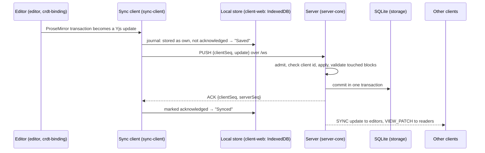

# Architecture overview

How Manent is put together, and how much of it exists. [layers.md](layers.md) has the dependency rules in full and [repository.md](repository.md) the folder outline. Every status on this page was read from the code on `main`:

| Mark            | Meaning                                                                                               |
| --------------- | ----------------------------------------------------------------------------------------------------- |
| **built**       | Does its job end to end, with tests, and is used by the running app or the tooling                    |
| **in progress** | Some of what the part is for works; the rest is missing or is a placeholder file that exports nothing |
| **planned**     | Decided, not written                                                                                  |

## What the system is

1. A script-writing app for film, series, shows, news, podcasts, books and games: true script pages, several people in one script, version history and production revisions.
2. It works offline. Every change is stored on the device first and sent when there is a connection; a change the server has acknowledged is never lost.
3. The editor is plain ProseMirror. Merging is done by a CRDT (Yjs) that exactly one package may import.
4. One server program (Bun and SQLite) is the authority for every synced script: it orders, checks, stores and passes on every change.
5. Today it runs as a demo on one machine, and the desktop app runs the same server program as a child process of its own. A hosted service is planned.

## The system in one diagram

```text
 BROWSER TAB (apps/web)                                     DESKTOP APP (apps/desktop)
 ┌─────────────────────────────────────────────────┐        ┌───────────────────────────────────────────┐
 │ React screens: chooser, Library (Search,        │        │ shell: window, menus, dialogs, updater,   │
 │   Folders, Favourites, Private, Trash), script, │        │   manent:// links, Prompter files folder, │
 │   Beside, Series & Board, Rundowns, read-only   │        │   Export everything on this device…       │
 │   History (/s/$docId/history), Prompter, Room,  │        │ the same web app in the window            │
 │   Reader (/r/$token), Send (Export, Sides,      │        │ local node (packages/local-node):         │
 │   Print, Draft, Issue, Recall), Project &       │        │   loopback service, SQLite store,         │
 │   Workspace settings (MOS, Templates), Prefs    │        │   offline FTS5 search, prompter control   │
 │                                       [built]   │        │   & LAN MOS relay, server relay  [built]  │
 │ editor: ProseMirror, pages, inline graphics &   │        └────────────────────┬──────────────────────┘
 │   chyrons, picker, find, changes, revision      │                             │
 │   marks, comments & notes, suggestions,         │                             │
 │   alternates, timing, Ink worker      [built]   │                             │
 │   CRDT binding · presence             [built]   │                             │
 │ sync client: link, journal, outbox,             │                             │
 │   history, production, prompter feed  [built]   │                             │
 │ local store: IndexedDB · asset cache · leader   │                             │
 │ service worker: app shell offline     [built]   │                             │
 └──────────────┬──────────────────────────────────┘                             │
                │ HTTP: sign-in, session, script, assets, sharing, drafts,       │
                │   private copy, driver, prompter, MOS, search, trash,          │
                │   workspace, API keys, notifications, /api/v1/*, history, prod │
                │ WebSocket /ws: one binary socket for every open script & feed  │
                ▼                                                                ▼
 ┌──────────────────────────────────────────────────────────────────────────────────────────────────┐
 │ SERVER PROGRAM (apps/server → server-core), one Bun process: the authority                       │
 │   HTTP edge: host and origin checks, routes, demo sign-in, sessions, static web app   [built]    │
 │   socket: single-use tickets, handshake, version gate, prompter feed hub              [built]    │
 │   rooms: one live document per open script; room-free viewer snapshot cache           [built]    │
 │   write path: admit → identity → apply → validate → commit → acknowledge → publish    [built]    │
 │   checkpoints on a worker thread · healing · reorganisations and replays              [built]    │
 │   collaboration: sharing, groups & links, comments, sent drafts, private hand-in      [built]    │
 │   broadcast: rundown durations, air windows, prompter leases, MOS 2.8.5 / WinPlus-IP  [built]    │
 │   workspace: FTS5 search catch-up, 30-day Trash, Can also, /api/v1/*, notifications   [built]    │
 │   version history: record, list, open, name, restore (scripts and rundowns)           [built]    │
 │   production revisions & assets: lock, issue, recall, layout changes, project assets  [built]    │
 └──────────────┬───────────────────────────────────────────────────────────────────────────────────┘
                ▼
   SQLite files: control.sqlite (people, roles, shares, trash, keys, outbox), search.sqlite (FTS5),
   one file per project or person (including project assets), and a .checkpoints.sqlite beside each
```

### Where it runs

| Setting            | Clients                                                       | Server program                                                              | Storage                                           | Status                                                                                                                                                                                                                                |
| ------------------ | ------------------------------------------------------------- | --------------------------------------------------------------------------- | ------------------------------------------------- | ------------------------------------------------------------------------------------------------------------------------------------------------------------------------------------------------------------------------------------- |
| Demo, one machine  | Browser tabs on `http://localhost:4747`; each tab is a person | On the same machine under a supervisor; loopback only                       | `.manent-demo/`: the session key and SQLite files | **built**                                                                                                                                                                                                                             |
| Demo, two machines | A second machine on the same private network                  | Also listens on one private-range address; refuses a public or wildcard one | The same                                          | **in progress**: `make demo LAN=1` listens; the browser keeps its offline copy of the app only on `localhost`                                                                                                                         |
| Desktop            | The app's own window                                          | A local node inside the app relays to the server, which stays the authority | SQLite in the system's app-data folder            | **built**: unsigned installers for macOS (`.dmg`), Windows (`-setup.zip`) and Linux (`.tar.gz`), with offline FTS5 search, Prompter files folder output, LAN MOS relay, `Export everything on this device…`, and `manent://` on macOS |
| Hosted             | Browsers and desktop apps                                     | The same program behind a proxy that ends TLS                               | The same files, with backups off the machine      | **planned**                                                                                                                                                                                                                           |

The demo replaces only sign-in. Sync, the write path, storage and recovery are the real ones, running locally.

## Packages

Dependencies point down; no edge points up. The layers and each package's allowed imports are data in `tools/boundaries.config.ts`, and [layers.md](layers.md) reads them out.

```text
 Presentation and composition   ui · demo · web · server · desktop                               screens, demo content, entry points
 Application                    crdt-binding · editor · commands                                 editing and the commands behind it
 Services                       sync-client · client-web · storage · server-core · local-node    sync, storage, the authority
 Domain engines                 pagination · revisions · crdt · formats                          the document's rules, as libraries
 Kernel                         schema · settings · sync-protocol · perf                         shared values and rules
 Tooling                        testkit · bench · e2e · tools                                    outside the layers
```

Every workspace, its job and its status:

| Package         | Layer                        | Responsibility                                                                                                                                                                                                                                                                                                                                                                                                                                                                                                       | Status                                                                                                                                                                                                                                                                                                                                                                                                                                                                                                                                                                                                                                                                                                                                                                                                                                                                                                                                                                                                                                                                                                                                                                                                                                                                                               |
| --------------- | ---------------------------- | -------------------------------------------------------------------------------------------------------------------------------------------------------------------------------------------------------------------------------------------------------------------------------------------------------------------------------------------------------------------------------------------------------------------------------------------------------------------------------------------------------------------- | ---------------------------------------------------------------------------------------------------------------------------------------------------------------------------------------------------------------------------------------------------------------------------------------------------------------------------------------------------------------------------------------------------------------------------------------------------------------------------------------------------------------------------------------------------------------------------------------------------------------------------------------------------------------------------------------------------------------------------------------------------------------------------------------------------------------------------------------------------------------------------------------------------------------------------------------------------------------------------------------------------------------------------------------------------------------------------------------------------------------------------------------------------------------------------------------------------------------------------------------------------------------------------------------------------- |
| `schema`        | Kernel                       | The document schema (version 5): sections, one block node, elements and marks of eight formats (including prose `subheading`, `epigraph`, chapter `targetWords`, opening styles `firstLine`, `sup`/`sub` and inline `footnote` marks), inline graphics, block identity, text anchors, rundown & prompter projection, Game Script playthrough walker, validation, repairs, canonical JSON                                                                                                                             | **built**                                                                                                                                                                                                                                                                                                                                                                                                                                                                                                                                                                                                                                                                                                                                                                                                                                                                                                                                                                                                                                                                                                                                                                                                                                                                                            |
| `settings`      | Kernel                       | The settings registry: definitions, validation, user, project and script scopes, the store, and every preference and script setting (including paperback trims, mirrored margins, right-hand chapters, Book/Chapter running heads and Table of Contents)                                                                                                                                                                                                                                                             | **built**                                                                                                                                                                                                                                                                                                                                                                                                                                                                                                                                                                                                                                                                                                                                                                                                                                                                                                                                                                                                                                                                                                                                                                                                                                                                                            |
| `sync-protocol` | Kernel                       | The wire: binary frames, messages, chunking, version gating, refusal codes, prompter control frames, and the bodies of the HTTP routes as shared types                                                                                                                                                                                                                                                                                                                                                               | **built**                                                                                                                                                                                                                                                                                                                                                                                                                                                                                                                                                                                                                                                                                                                                                                                                                                                                                                                                                                                                                                                                                                                                                                                                                                                                                            |
| `perf`          | Kernel                       | Timing marks that ship in the product, off until switched on, in a fixed ring buffer                                                                                                                                                                                                                                                                                                                                                                                                                                 | **built**                                                                                                                                                                                                                                                                                                                                                                                                                                                                                                                                                                                                                                                                                                                                                                                                                                                                                                                                                                                                                                                                                                                                                                                                                                                                                            |
| `pagination`    | Domain engines               | The page engine: versioned pure functions (v1, v2, and opt-in v3 Book Publishing with Source Serif 4 FUnit metrics, 5×8″/5.5×8.5″/6×9″ trims, mirrored margins, shared running-header resolution with chapter-opening suppression, optional blind-folio blank verso pages for right-hand chapter starts, and Roman-numeral front matter + auto-generated TOC) from blocks to positioned lines                                                                                                                        | **built**                                                                                                                                                                                                                                                                                                                                                                                                                                                                                                                                                                                                                                                                                                                                                                                                                                                                                                                                                                                                                                                                                                                                                                                                                                                                                            |
| `revisions`     | Domain engines               | Block-aligned script compare, row-aligned rundown compare, three-way merge by block, anchor resolution, restore plans, script and manuscript-only Book checks, rename character, script numbers, and the production model                                                                                                                                                                                                                                                                                            | **built**                                                                                                                                                                                                                                                                                                                                                                                                                                                                                                                                                                                                                                                                                                                                                                                                                                                                                                                                                                                                                                                                                                                                                                                                                                                                                            |
| `crdt`          | Domain engines               | The only importer of Yjs: documents, additive `bookMatter(doc)` over `titlePage`, rundowns, templates strip/mint, body view, index maps, writes addressed to a block, reorganisations, awareness, undo scope                                                                                                                                                                                                                                                                                                         | **built**                                                                                                                                                                                                                                                                                                                                                                                                                                                                                                                                                                                                                                                                                                                                                                                                                                                                                                                                                                                                                                                                                                                                                                                                                                                                                            |
| `formats`       | Domain engines               | Files in and out: PDF (cover, Roman front matter + TOC, Source Serif 4 Engine 3 books, endnotes, back matter, continuous multi-part pagination), pure-TS EPUB 3 (`.epub`, cover, front/back matter, nested TOC & landmarks), round-trip Word (`.docx`) read & write, lossless Markdown (`.md`) read & write, multi-part book compile, Sides PDF, issued revision packet, MOS 2.8.5 / Autoscript WinPlus-IP wire encoding, rundown PDF/text/JSON, CSV & PDF reports, Game Script JSON & XML, Ink, FDX, Fountain & zip | **built**                                                                                                                                                                                                                                                                                                                                                                                                                                                                                                                                                                                                                                                                                                                                                                                                                                                                                                                                                                                                                                                                                                                                                                                                                                                                                            |
| `sync-client`   | Services                     | The client's sync: the link state machine, journal and outbox, handshake, leader and follower tabs, read-only `ViewHandle`, recovery, versions, production and prompter feed client, all behind ports                                                                                                                                                                                                                                                                                                                | **built**                                                                                                                                                                                                                                                                                                                                                                                                                                                                                                                                                                                                                                                                                                                                                                                                                                                                                                                                                                                                                                                                                                                                                                                                                                                                                            |
| `client-web`    | Services                     | The sync client's browser drivers: IndexedDB store, project-scoped offline asset cache and uploader, Web Locks leader with a lease fallback, socket and fetch transport, the production cache                                                                                                                                                                                                                                                                                                                        | **built**                                                                                                                                                                                                                                                                                                                                                                                                                                                                                                                                                                                                                                                                                                                                                                                                                                                                                                                                                                                                                                                                                                                                                                                                                                                                                            |
| `storage`       | Services                     | Storage ports and their drivers: SQLite (schema version 13 with compressed checkpoints and `doc_directory_by_home_kind` lookup index, derived FTS5 `search.sqlite`, project-scoped assets and outbox) for the server and local node, in memory for tests                                                                                                                                                                                                                                                             | **built**                                                                                                                                                                                                                                                                                                                                                                                                                                                                                                                                                                                                                                                                                                                                                                                                                                                                                                                                                                                                                                                                                                                                                                                                                                                                                            |
| `server-core`   | Services                     | `createServer()`: HTTP, static caching & CSP, sign-in, sessions, socket, rooms, write path, checkpoints, healing, sharing, comments, drafts, private copies, rundowns, live prompter control, MOS bridge, assets, search & API                                                                                                                                                                                                                                                                                       | **built**                                                                                                                                                                                                                                                                                                                                                                                                                                                                                                                                                                                                                                                                                                                                                                                                                                                                                                                                                                                                                                                                                                                                                                                                                                                                                            |
| `local-node`    | Services                     | The desktop's loopback service: durable SQLite store, offline-first cloud reachability gating & automatic recovery (`GET /api/local/status` + SSE `cloud_state`), offline FTS5 search, Prompter files folder writer, prompter control & LAN MOS relay, outbox, local export-all, single-instance lock, first-sync                                                                                                                                                                                                    | **built**                                                                                                                                                                                                                                                                                                                                                                                                                                                                                                                                                                                                                                                                                                                                                                                                                                                                                                                                                                                                                                                                                                                                                                                                                                                                                            |
| `crdt-binding`  | Application                  | Binds a CRDT document to the editor: y-prosemirror, undo history, composition hold, presence                                                                                                                                                                                                                                                                                                                                                                                                                         | **built**                                                                                                                                                                                                                                                                                                                                                                                                                                                                                                                                                                                                                                                                                                                                                                                                                                                                                                                                                                                                                                                                                                                                                                                                                                                                                            |
| `editor`        | Application                  | `createScriptEditor`: element flow and keys, Book cover & front/back matter sheet, inline footnotes, inline graphics and chyrons, picker, autocomplete, find, paged view (with Engine 3 serif metrics and blind-folio blank verso breaks), drift monitor, remote cursors, comments & notes, suggestions, alternates, revisions, Ink                                                                                                                                                                                  | **built**                                                                                                                                                                                                                                                                                                                                                                                                                                                                                                                                                                                                                                                                                                                                                                                                                                                                                                                                                                                                                                                                                                                                                                                                                                                                                            |
| `commands`      | Application                  | The command registry: definitions, key bindings and chords, rebinding checks, contextual recommendations and frecency, the menu model                                                                                                                                                                                                                                                                                                                                                                                | **built**                                                                                                                                                                                                                                                                                                                                                                                                                                                                                                                                                                                                                                                                                                                                                                                                                                                                                                                                                                                                                                                                                                                                                                                                                                                                                            |
| `ui`            | Presentation and composition | Components, Bound "M" brand kit, 24 studio palettes & interactive Hidden Gem Collector Vitrine (24 scenes, bursts & foley), command palette, sortable lists, surfaces, theme tokens and every word the interface shows                                                                                                                                                                                                                                                                                               | **built**                                                                                                                                                                                                                                                                                                                                                                                                                                                                                                                                                                                                                                                                                                                                                                                                                                                                                                                                                                                                                                                                                                                                                                                                                                                                                            |
| `demo`          | Presentation and composition | Demo people and workspaces, password-less sign-in, the Tour's format, 93 scenarios and seven canonical story tracks, seeded projects covering all eight project kinds and eight formats in Writers' room alongside Sam's desk and Lanternfield Studios, inline graphics and chyrons, reusable templates, nested folders, persona favourites, Private drafts and simulated writers                                                                                                                                    | **built**: people, workspaces, sign-in, seeded content (all eight project kinds and formats in Writers' room, enriched Book publishing showcase, inline graphics and chyrons, reusable Show/News templates, nested folders, persona favourites, Private drafts and Trash), simulated writers, seven canonical story tracks and all 93 active Tour scenarios (zero hidden) across web and desktop covering writing, book publishing, library organisation, collaboration, production, rundowns, prompter, MOS, graphics & history                                                                                                                                                                                                                                                                                                                                                                                                                                                                                                                                                                                                                                                                                                                                                                     |
| `web`           | Presentation and composition | The installable offline browser app (PWA): Studio Desk chooser, Library, Search, Folders, Trash, script & Beside, Book studio (floating format bar, cover & front/back matter sheet, Footnotes inspector, Book checks, facing spreads & multi-part compile), smart Command Palette (`⌘K`), Comments, Share, archival Send, Reader, Room window, Series Overview & printable 2D Board, Rundowns, dedicated read-only History, Prompter, Broadcast MOS, unified Settings shell, graphics, templates, Ink & SW          | **built**: Studio Desk chooser, writing (including contextual floating Book format bar with Drop cap / Raised cap / Flush-left openings, Colour & Highlight swatches, Superscript/Subscript, inline Footnotes, Single/Double line spacing, live word counts, in-editor Book cover & front/back matter sheet, Book-only `Details → Book → Footnotes` inspector, manuscript-only pre-export Checks, Engine 3 `Single / Spread` facing-page export preview, lossless Markdown `.md` round-trip and Multi-Part Book Compile via `Add part` / `Whole book`), sync, smart Command Palette (`⌘K` Smart Home, `Jump to`, in-place switches, direct jumps and numeric prefill), installable offline PWA with first-visit background offline-readiness prompt, safe SW updates and browser backup, Library, collaboration, showrunner Series Overview & printable 2D Board (with Scene Peek, flags & shortcuts), archival Send & Reader (including standalone interactive Ink Reader Player on `/r/$token`), unified Preferences/Project/Workspace settings shell (with template `Custom` defaults and additive `settings_meta` provenance), rundowns, remote prompter, MOS settings, inline graphics, templates, search & Trash, Ink & writing tools, public API UI, dedicated read-only history & production |
| `server`        | Presentation and composition | Reads the environment, opens SQLite storage, search index and a checkpoint worker, seeds the demo, starts the notification loop, creates the server and listens                                                                                                                                                                                                                                                                                                                                                      | **built**                                                                                                                                                                                                                                                                                                                                                                                                                                                                                                                                                                                                                                                                                                                                                                                                                                                                                                                                                                                                                                                                                                                                                                                                                                                                                            |
| `desktop`       | Presentation and composition | The desktop shell: custom theme-matched window chrome (macOS/Windows main, Room/Prompter & bespoke About Manent windows), display-aware `1440 × 940` sizing, unified Bound "M" OS icons, native menus, dialogs, 6-hour periodic updater, `manent://` links & Finder/Dock file associations, Prompter files folder writer, local-node host (with LAN MOS relay) and the app's own server process                                                                                                                      | **built**                                                                                                                                                                                                                                                                                                                                                                                                                                                                                                                                                                                                                                                                                                                                                                                                                                                                                                                                                                                                                                                                                                                                                                                                                                                                                            |
| `testkit`       | Tooling                      | Test support: temporary trees, a test server, bots, seeded sync, production, desktop and mock MOS prompter simulations, fuzzers, DOM setup                                                                                                                                                                                                                                                                                                                                                                           | **built**                                                                                                                                                                                                                                                                                                                                                                                                                                                                                                                                                                                                                                                                                                                                                                                                                                                                                                                                                                                                                                                                                                                                                                                                                                                                                            |
| `bench`         | Tooling                      | The benchmark harness, statistics, budgets, writing, sync, broadcast, search, Ink and desktop scenarios and report builder                                                                                                                                                                                                                                                                                                                                                                                           | **built**: the harness, scenarios, report builder and published report ([docs/benchmark/report.md](../benchmark/report.md), covering standard `D-small` server benchmarks, six-tier proof runs and macOS desktop smoke at `a44b0bc8`; standard `D-modest`/`D-typical`/`host` client tiers and Windows/Linux desktop smoke remain unmeasured)                                                                                                                                                                                                                                                                                                                                                                                                                                                                                                                                                                                                                                                                                                                                                                                                                                                                                                                                                         |
| `e2e`           | Tooling                      | End-to-end tests in Chromium, Firefox and WebKit, Tour runner, desktop smoke tests and the fresh-clone test                                                                                                                                                                                                                                                                                                                                                                                                          | **built**                                                                                                                                                                                                                                                                                                                                                                                                                                                                                                                                                                                                                                                                                                                                                                                                                                                                                                                                                                                                                                                                                                                                                                                                                                                                                            |
| `tools`         | Tooling                      | The gate's checks, the demo launcher and supervisor, the Unicode and theme scripts (including the standalone 24-gem Museum showcase), the desktop build tools                                                                                                                                                                                                                                                                                                                                                        | **built**                                                                                                                                                                                                                                                                                                                                                                                                                                                                                                                                                                                                                                                                                                                                                                                                                                                                                                                                                                                                                                                                                                                                                                                                                                                                                            |

## Seams

Each seam is an interface placed where a replacement is plausible.

| Seam                | Where                  | Why                                                                                                                                                         | Behind it today                                                                                                          |
| ------------------- | ---------------------- | ----------------------------------------------------------------------------------------------------------------------------------------------------------- | ------------------------------------------------------------------------------------------------------------------------ |
| CRDT library        | `crdt`, `crdt-binding` | Versions, compare, restore and revisions work on plain documents and block IDs, so they survive a change of library                                         | Yjs. The boundary check lets only these two packages import it                                                           |
| Storage             | `storage`              | The server is written against ports, so another driver can replace SQLite                                                                                   | SQLite (`bun:sqlite`) and an in-memory driver with fault injection                                                       |
| Sign-in             | `server-core`          | The demo needs password-less people, a hosted release a real provider; sessions and roles stay the same code                                                | The demo's provider in `demo`                                                                                            |
| Transport and clock | `sync-client`          | The client is pure: socket, storage, timers, locks and the clock are passed in, so the same code runs in a browser, the desktop and a simulation            | Browser drivers in `client-web`; simulated ones in `testkit`                                                             |
| Desktop shell       | `apps/desktop`         | All but the window, menus and updater lives in `local-node`, so the shell can be replaced                                                                   | Electrobun                                                                                                               |
| Files               | `formats`              | A PDF reads the page engine's output, not the screen, so it has the editor's pages by construction; the script and book formats read and write the document | The PDF, EPUB 3, Word (`.docx`), Markdown (`.md`), multi-part Book compile, packet, FDX and Fountain readers and writers |

## Document model

```text
doc ── section+ ── block+ ── text*
```

- **One document per script.** A film or a book-length manuscript is one document.
- **`section`** is an invisible container of about 100 blocks. It is never shown or selectable; it lets the browser skip content that is off screen.
- **`block`** is the only content node. Its element (Scene Heading, Action, Dialogue and so on) is an attribute, not a node type, so changing an element never deletes text someone else is typing into the block.
- **No merge can make a document invalid.** Every attribute has a default and no node needs more than one child. An element written by a newer build is kept and drawn as General.
- **Stable block identity.** Every block has its own `id`. Scene numbers, locks and revision records key on it, never on a CRDT-internal identifier. A split keeps the ID on the first half; a join keeps the earlier block; a paste makes new IDs.
- **Validation has three outcomes:** _reject_ (structurally invalid), _newer_ (written by a newer schema: kept) and _repair_ (put right, never refused). The server's write path validates only the blocks a change touched.

| Stored in the script's CRDT document                             | Ordered by the server, in SQLite, never merged                             | Derived, never stored                                                                   |
| ---------------------------------------------------------------- | -------------------------------------------------------------------------- | --------------------------------------------------------------------------------------- |
| Sections, blocks, text, marks, block attributes; script settings | Versions and named drafts, revision sets, page locks, issued scene numbers | Page breaks, page numbers, (MORE) and (CONT'D), scene numbers, the status a person sees |

Anything that must mean one thing to everyone, such as a version or a lock, is ordered by one authority. Anything that can be computed from the document is computed, so it cannot go stale. Script settings live in maps that only the server writes, at a person's request.

## A change, step by step



1. **In the editor.** `createScriptEditor` (`packages/editor`) is bound to the script's Yjs document by `bindDocument` (`packages/crdt-binding`). y-prosemirror writes each transaction into the document; remote updates are held back while a person composes text with an input method.
2. **On the device.** The sync client sees the local update and the journal stores it with "own, not acknowledged" (`packages/sync-client/src/session/journal.ts`). In a browser the store is IndexedDB, one database per person (`packages/client-web/src/idb-store.ts`). The status says **Saved** once the write lands.
3. **One tab talks.** Only one tab per person holds the connection, chosen by a Web Lock or, where there are none, a lease in IndexedDB. Other tabs pass their changes to it over a BroadcastChannel.
4. **To the server.** The link asks `POST /api/ws-ticket` for a single-use ticket and opens `/ws`. For each script it subscribes, exchanges state vectors, then sends the outbox in batches as `PUSH` frames, each waiting for its acknowledgement.
5. **The write path** (`packages/server-core/src/sync/write-path.ts`): admission (edit rights, current document, rate and size limits), client-id ownership, apply to the room's live document, validate the touched blocks and refuse writes to the server-only settings maps, then queue.
6. **Commit, then acknowledge.** Queued changes are committed to the project's SQLite file in one transaction. Only then does the server send `ACK`, and pass the change to the room's other editors as `SYNC` and to viewers as `VIEW_PATCH`.
7. **Back on the device.** `ACK` marks the journal's entries acknowledged; two seconds after nothing waits, the status says **Synced**. Remote updates are applied at most once per animation frame.

**Offline.** Steps 1 to 3 happen as before. The change stays in the outbox, across reloads, until a connection returns. Then the client subscribes again, the two sides exchange what each lacks, and the outbox is sent; a change the server already has is acknowledged again, not applied twice. If the server refuses a change for good, the client keeps its copy as a version on the device, reloads the server's state and merges its own changes back block by block; text that cannot be placed is kept as recovered text. If the document was reorganised meanwhile, waiting changes are replayed once through `POST /api/docs/replay`.

## Storage

- **Drivers.** SQLite in production (`packages/storage/src/sqlite/`, schema version 13 with query indexes on sharing, draft sends/opens, revision issues, checkpoint pins and `doc_directory_by_home_kind`, compressed checkpoints, project-scoped asset tables, derived FTS5 `search.sqlite` and notification outbox tables), and an in-memory driver with transactional rollback parity and fault injection for tests and the simulation.
- **Files and durability.** `control.sqlite` holds people, roles, share links, sent drafts, Trash records, API key hashes, notification outbox rows and tombstones. Each project, and each person's own desk, has its own file, `project-<id>.sqlite` or `user-<id>.sqlite`, and a `.checkpoints.sqlite` beside it. Primary files keep full SQLite durability (`synchronous = FULL` and `fullfsync` on macOS); derived caches (`.checkpoints.sqlite` and `search.sqlite`) use `normal` durability and disposable staging seeds use `off` (`docs/decisions/0059-tiered-storage-durability-and-on-demand-delivery.md`). In the browser, IndexedDB keeps `strict` durability for unsynced writing and recovered passages, uses `relaxed` durability for replaceable cache and metadata writes, and reads document lists from bounded metadata summaries without loading CRDT blobs.
- **What is in a file.** An append-only log of updates per document, the clients that wrote them, quarantined rows and healing marks, reorganisation epochs and replays, versions stored as content-addressed chunks, one per scene, project-scoped graphic assets, and production's tables: page locks, revision sets and their blocks, issues, issued scene numbers and request keys.
- **Checkpoints** are built on a worker thread (`durability: "normal"`, a 2-entry warm CRDT document LRU so consecutive jobs apply only incremental tails, direct Yjs XML tree walking in `measureDoc` reusing the encoded state length, and transparent level-1 `deflateRawSync` compression verified by canonical SHA-256), so a room loads the newest checkpoint and the log after it. A row that does not read is quarantined and the document is marked for healing.
- **In the demo** everything lives under `.manent-demo/data/`; `make reset` deletes it.

## The server

- **Routes.**
  - Core, auth and demo: `GET /health`; `GET` and `POST /api/sign-in`, `GET /api/me`, `GET /api/demo`, and demo control routes; `POST /api/ws-ticket` and `GET /ws`.
  - Documents, assets, history and production: `POST /api/docs` and `/api/docs/{remove,adopt,describe,replay,clients,removed,people}`; `/api/projects/:projectId/assets/:assetId`; `GET /api/versions`, `/api/versions/{content,who,since}` and `POST /api/versions/{name,save,upload,restore,authors}`; `POST /api/production/{state,lock,pages,layout,issue,recall,unlock,end,import,file}`.
  - Collaboration, room and private copies ([working-together.md](working-together.md)): `/api/share/{people,grant,remove,grant-group,remove-group,link,revoke-link,join}`; `/api/drafts/{send,sends,open,since,pdf}`; `/api/private/{create,handin}`; `/api/driver/{current,take,release}`.
  - Prompter and MOS ([prompter.md](prompter.md), [rundowns.md](rundowns.md)): `/api/prompter/{send,send-previous}`, `/api/prompter/operator/{take,release}`, `/api/prompter/control`, `/api/workspaces/:workspaceId/mos`, `/api/prompter/:docId/mos`, plus `SUBSCRIBE(mode: "prompter")` over `/ws`.
  - Search, Trash, Workspace settings, notifications and public API ([workspace-search-and-ink.md](workspace-search-and-ink.md)): `GET /api/search`; `/api/trash/{move,restore,list}`; `/api/workspace/{settings,people,people/role,api-keys,api-keys/create,api-keys/revoke,notifications,notifications/set}`; and read-only `GET /api/v1/{folder,lines,fdx,ink}` (API-key authenticated).
  - Any other path serves the built web app.
- **Edges.** A request must name the server's own host; the socket also checks the origin. The demo server listens on loopback, and on one private-range address with `MANENT_LAN_HOST`; it refuses a public or wildcard address, because the demo has no passwords.
- **Sessions** are signed with a key kept in the data folder. **Tickets** for the socket are single-use and short-lived.
- **Reorganisations.** When a document's CRDT grows past its budget, it is reorganised into a new, compact document once its room is quiet, and clients are told to move.
- **History.** The history service records, lists, opens, names, thins and restores versions for both scripts and rundowns (requiring `edit_rundowns` inside the serialisation queue for rundown writes), keeps them across reorganisations and storage compaction, and says who wrote a passage.
- **Broadcast prompter, MOS and assets.** `PrompterFeedHub` serves live prompter feeds, server-arbitrated operator scroll leases (`/api/prompter/operator/{take,release}`, `/api/prompter/control`) and the outbound MOS 2.8.5 / Autoscript WinPlus-IP TCP bridge (`/api/workspaces/:workspaceId/mos`, `/api/prompter/:docId/mos`), ensuring air-window holds govern both the browser Prompter window and external hardware prompters. Project-scoped inline graphic binaries live under `/api/projects/:projectId/assets/:assetId` with SHA-256 verification and per-project storage quotas.
- **Production.** The production service locks a script's page and scene numbers, changes pages and layout on a locked script, issues a revision once and starts the next, and recalls one within a day; only the server writes issued scene numbers.

## Pages

The page engine (`packages/pagination`) is a pure function from a document's blocks, a page profile and the locks to positioned lines on pages. Engines v1 and v2 measure Courier Prime on a fixed grid from precomputed tables, and opt-in Engine v3 (Book Publishing) measures bundled Source Serif 4 from precomputed FUnit tables across five trim sizes with mirrored margins, alternating running heads and optional right-hand chapter starts, so the same input gives the same pages in every browser and in Bun. Engines are versioned, so a script keeps its layout when the engine changes.

The editor runs the engine inside a ProseMirror plugin's state, after every change, and repaginates only what the change can reach. Pagination decorations mirror production layout patches on screen (`OMITTED` headings and hidden omitted-scene bodies) so DOM height matches the engine, while a drift monitor holds the browser's line wrapping to the engine's line starts. Whenever `changesPlugin` renders inline deletions or screenplay-formatted removed blocks (`del.el`, with trailing removals ordered strictly before `pb-last`) on the page, `sheetBoxSyncPlugin` keeps `.mn-sheet` underlays and `.mn-zoom` height synced to rendered `.pb-head` / `.pb-foot` boundaries via `PageScaffold.setPageBoxes` (absorbing extra diff height into `.pb-fill` via `--fill-trim` before expanding overflowing sheets, with bottom-anchored footers) and resets to fixed-pitch layout once changes hide. On passive scroll, the editor bridge resolves the reading-zone heading in O(log n) over visible blocks and publishes it to the outline store's isolated viewed channel for Scenes Ghost Follow. Print draws the engine's pages, and the PDF writer (`packages/formats`) draws the same positioned lines.

## History and production revisions

- **Merging and comparing** (`packages/revisions`) are built: a block-aligned compare drives the editor's changes layer, row-aligned rundown compare drives Rundown History, and a three-way merge by block is used by recovery, private-copy hand-in and replays on the server.
- **Version history** is built on the server and on the device for both scripts and rundowns: the top-bar **History** button beside **Share** opens a dedicated read-only `/s/$docId/history` screen (keeping the live editor mounted underneath without allowing edits) with a floating right-edge Change-Aware Minimap TOC, auto-fitted script comparisons (`On the page` and lockstep `Side by side` with DOM-synced per-page sheets and screenplay-formatted removed blocks, `Asterisks only` with right-margin asterisks via `changeMarksPlugin`, and `As it was`) and rundown diffs (`In the grid`, `Side by side`, `As it was`), named drafts, and full or single-scene/single-row restore.
- **Production revisions** are built: the model in `revisions`, the packet and Sides writers in `formats`, storage, the server's service, the client in `sync-client` and `client-web`, the editor's marks, and the screens (the lock dialogs including Try it on a copy first, the Pages tab, and Issue, Recall and Sides on the Send screen).

## Where to start reading

| File                                                                           | What it shows                                                                                                |
| ------------------------------------------------------------------------------ | ------------------------------------------------------------------------------------------------------------ |
| [AGENTS.md](../../AGENTS.md), then [the decisions](../decisions/README.md)     | The standing rules, and why each constraint exists                                                           |
| `tools/boundaries.config.ts`                                                   | The dependency rules as data: one row per workspace                                                          |
| [working-together.md](working-together.md)                                     | Comments and anchors, sharing, groups and links, sent drafts, suggestions, private copies and Room window    |
| [projects-and-series.md](projects-and-series.md)                               | Project index maps, shared styles, page furniture, series episodes, room documents and the series Board      |
| [rundowns.md](rundowns.md)                                                     | Variety and Podcast timing, collaborative Show and News rundowns, server durations and air windows           |
| [prompter.md](prompter.md)                                                     | One prompter projection, manual and 2 s automatic sends, Send previous, live feed and desktop prompter files |
| [workspace-search-and-ink.md](workspace-search-and-ink.md)                     | Full-text search, folders and Trash, Workspace settings, Can also, public REST API, notifications and Ink    |
| `packages/schema/src/schema.ts`, `identity.ts`, `validate.ts`                  | The document model                                                                                           |
| `packages/sync-protocol/src/messages.ts`, then `codec.ts`                      | Every message, then how it becomes bytes                                                                     |
| `packages/crdt/src/index.ts`                                                   | The CRDT interface                                                                                           |
| `packages/editor/src/script-editor/create.ts`                                  | How the editor is assembled                                                                                  |
| `packages/sync-client/src/session/local-copy.ts`, `journal.ts`, `handshake.ts` | One script's sync on the device                                                                              |
| `packages/server-core/src/sync/write-path.ts`, then `service.ts`               | What the server does with a change                                                                           |
| `packages/pagination/src/engines/v1/paginate.ts`                               | The page engine                                                                                              |
| `apps/server/src/main.ts`, `apps/web/src/router.tsx`                           | How the two apps compose the packages                                                                        |
