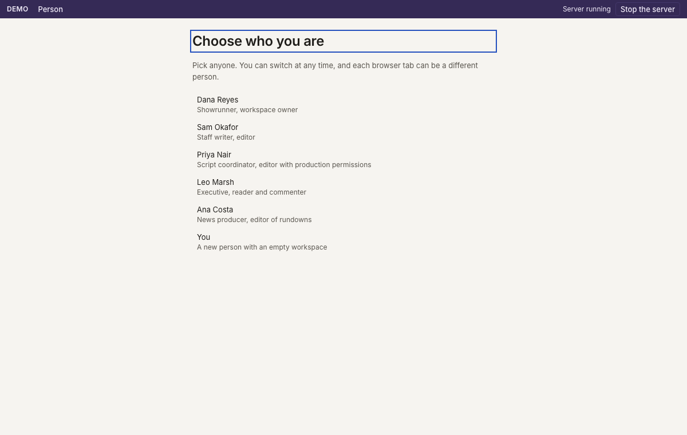

# Getting started

How to run Manent on your own machine and find your way around the demo.

## What you need

- [Bun](https://bun.com) 1.4.4 or later. `make demo` checks the version first and tells you how to install Bun if it is missing.
- Git, to get the code.
- macOS, Linux or Windows. The test suite runs on all three.
- A current Chromium-based browser, Firefox or Safari. The end-to-end tests run in Chromium, Firefox and WebKit.
- `make` is optional. Every `make` target runs a `bun run` script of the same name, so `bun run demo` does the same as `make demo`.

## Start the demo

```sh
git clone https://github.com/HMarzban/manent.git
cd manent
make demo
```

The first run takes a little longer. `make demo`:

1. checks your Bun version and that ports 4747 and 4748 are free;
2. installs the dependencies from the lockfile;
3. builds the web app;
4. creates the demo data in `.manent-demo/` (the demo people and their workspaces);
5. starts the server under a small supervisor, which restarts it if it stops on its own;
6. opens `http://localhost:4747` in your browser.

To stop it, press Ctrl+C in the terminal, or run `make stop` from another one. `make reset` deletes the demo data and creates it again.

## Choose who you are



The demo has no passwords. You choose a person with one click:

| Person         | Role in the demo                                      |
| -------------- | ----------------------------------------------------- |
| A showrunner   | Owns the shared workspaces                            |
| A staff writer | Editor; has a desk of their own and the writers' room |
| A coordinator  | Editor with production permissions                    |
| An executive   | Reader and commenter                                  |
| A producer     | Editor of news rundowns                               |
| You            | A new person with an empty workspace, not signed in   |

Each browser tab is its own person, so two tabs can be two people. Switch person from the bar at the top ("Person: …") or from the person menu in the Library.

## The demo bar

A purple bar labelled **Demo** sits at the top of every screen. It shows who you are (click to switch), whether the server is running, and two buttons:

- **Stop the server** and **Start the server.** Stopping the server is the quickest way to see Manent work without a connection. See [Saving and syncing](saving-and-syncing.md).
- **Tour** opens the Tour panel.

## The Library

The Library lists the projects of one workspace. Choose the workspace from the menu at the top left. Each demo person belongs to one or more workspaces, such as a personal desk, a writers' room or a studio.

- **New script** makes a film project with one empty script and opens it.
- **New project** offers Film, Series, Show, News, Podcast, Book, Game and Stage play. In this build every kind starts with one Screenplay script; change its format in **Details → Script settings**.

> [!NOTE]
> In this build the Library list lives in the tab's memory. After a reload it starts empty again. Your scripts are not lost: they are kept on the device and on the server, and the address `/s/<id>` opens one again.

## The Tour

The Tour panel opens the first time you reach the Library. It is meant to be a guided walk through the demo, in eight groups: Write, Work together, Go offline, History, Production, Long documents, Rundown and prompter, and Desktop. In this build the groups are headings only: no scenario is written yet.

## What to try

1. Choose a person and click **New script**.
2. Type `INT. LIGHTHOUSE - NIGHT`, press Escape to close the list of headings, then Enter. Type a line of action, press Tab, type a name, press Enter and type what they say. See [Writing a script](writing.md).
3. Watch the status beside the title: **Saved** as you type, then **Synced**.
4. Click **Stop the server** in the demo bar and keep typing. The status says "Can't reach Manent, 1 waiting". Click **Start the server**; after a few seconds it says **Synced** again.
5. Open the script's address in a new tab and choose the same person. The script opens there too, with the other tab's cursor drawn by name, and an edit in either tab appears in both.
6. Open the command palette with Ctrl+K (⌘K on a Mac), type "Export" and press Enter to save the script as a PDF. See [Export and print](export-and-print.md).

## Let a second machine join

```sh
make demo LAN=1
```

The server then also listens on one private address of your machine (in 10.0.0.0/8, 172.16.0.0/12 or 192.168.0.0/16) and prints it as "On your network: …". It refuses a public address, because the demo has no passwords. Use it only on a network you trust.

A browser keeps Manent's offline copy of the app only on a secure address. `localhost` is one; a private address over plain HTTP is not, so the second machine needs the server to stay reachable.

## Change the ports or the data folder

`make demo` takes no options, but the script behind it does:

```sh
bun tools/demo/cli.ts demo --port 4800 --control-port 4801 --data-dir /tmp/manent-demo --no-open
```

| Option                | Default         | What it sets                                               |
| --------------------- | --------------- | ---------------------------------------------------------- |
| `--port`              | 4747            | The address of the app                                     |
| `--control-port`      | 4748            | The supervisor that the demo bar's buttons talk to         |
| `--data-dir`          | `.manent-demo/` | Where the demo data, the session key and the run file live |
| `--no-open`           | opens a browser | Leaves the browser closed                                  |
| `--lan`, `--lan-host` | off             | The same as `LAN=1`; `--lan-host` names the address        |

Stop it with `bun tools/demo/cli.ts stop --data-dir <the same folder>`.

## If something goes wrong

- **"Port 4747 is in use."** Another demo may still be running. Run `make stop`, or stop whatever holds the port.
- **"Can't reach Manent. Start the server, then choose again."** The server is stopped. Click **Start the server** in the demo bar, or run `make demo` again.
- **"The demo is not running. Run make demo again."** The supervisor has gone. Run `make demo`.
- **The browser did not open.** Open `http://localhost:4747` yourself.
